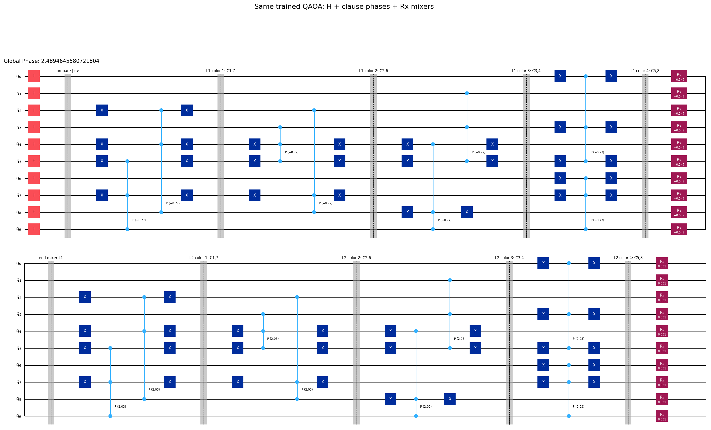
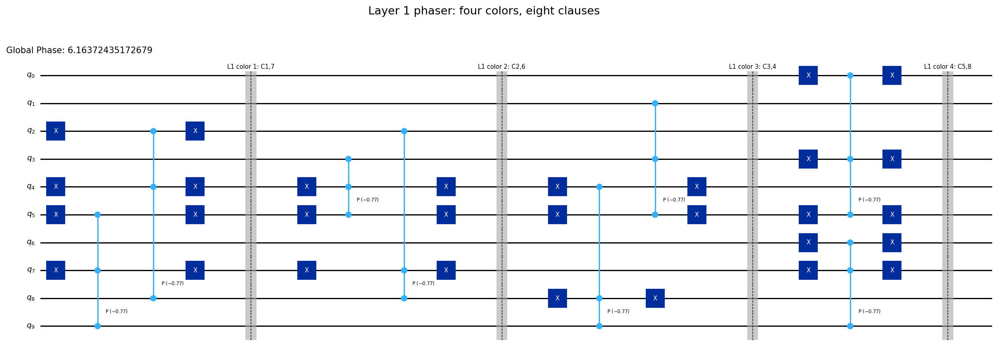
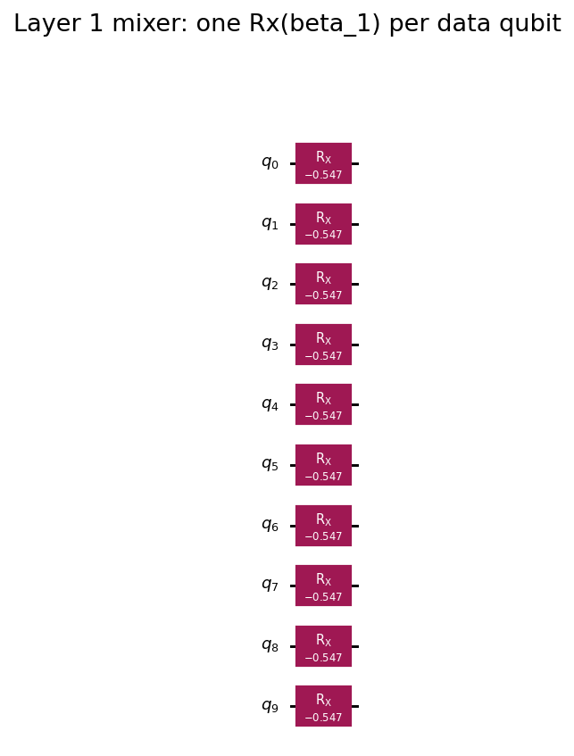
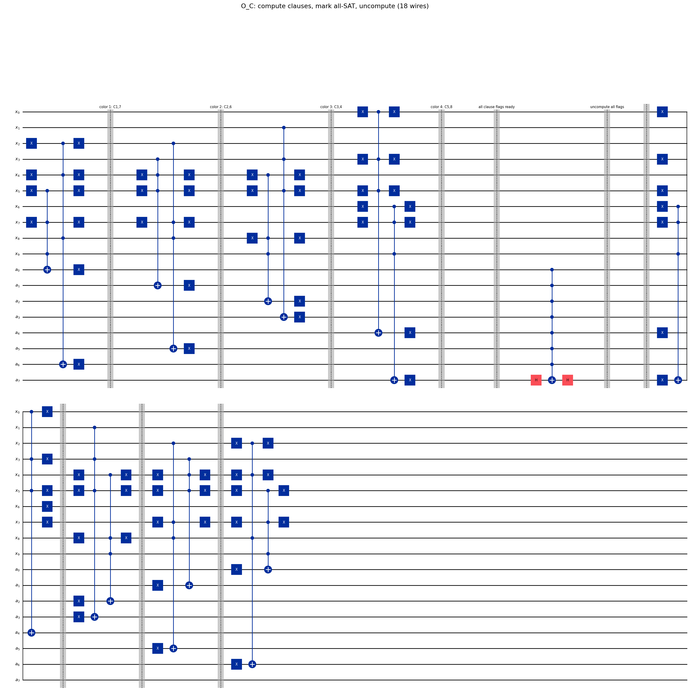
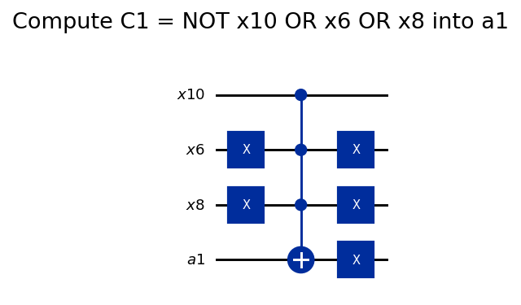
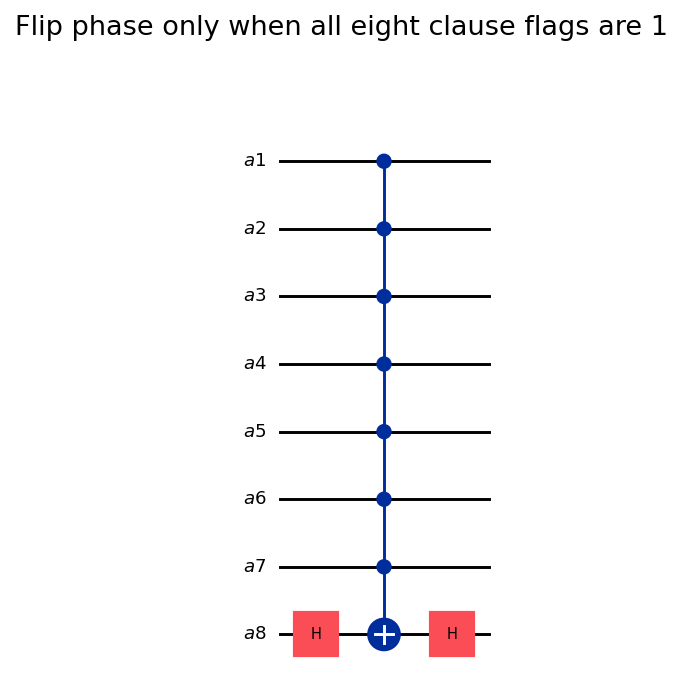
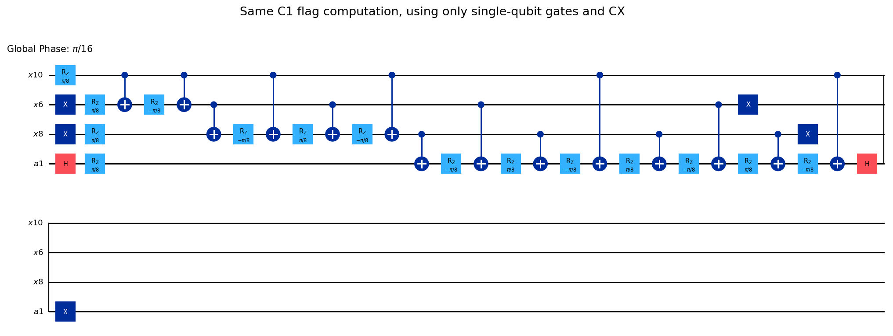

# 大方框展开后：QAOA 和 O_C 电路怎么读

对应 [实验 Notebook](../notebooks/QAOA_AA_3SAT_No_QEC.ipynb) 中新增的两个小节：

- 第 4 节后面的“展开大方框：QAOA 的实际门电路”。
- 第 5 节里面的“展开大方框：O_C 内部怎样核验 SAT”。

原概览图中的 `phaser`、`mixer`、`compute all clause flags` 等大方框，是为了排版而封装的子电路，不是一枚基本物理门。下面使用同一份 CNF 和已训练的 p=2 参数显示其内部结构。

## 1. 代码为什么画成大方框

原绘图调用为：

```python
qaoa_circuit(N, clauses, gammas, betas, boxed=True)
sat_oracle_with_flags(N, clauses, boxed=True)
```

`boxed=True` 会调用 `to_gate(...)`，把多枚门封装起来。设置为 `boxed=False` 后，代码使用 `compose(...)` 直接组合内部的门。

新的视图进一步标出各层和四个分色批次。用来分隔阶段的 barrier 只辅助阅读，不改变电路的酉变换。展开图已经与原电路作数值等价性核验。

## 2. 完整 QAOA：两层里实际有什么



从左向右读；若图被折成多段，沿每根同名线接着往下一段读，不是重新开始一组量子比特。

```text
H（10 根线）
第 1 层：4 个颜色批次的子句相位门，然后每根线 Rx(beta_1)
第 2 层：4 个颜色批次的子句相位门，然后每根线 Rx(beta_2)
```

每根 `q0…q9` 对应外部 CNF 的 `x1…x10`。本次参数是：

```text
gamma_1 =  0.7704648034    beta_1 = -0.5471357961
gamma_2 = -2.0300756987    beta_2 =  0.3309903021
```

相位器中实际画在失败图样上的角度是 **-gamma**，所以第一层的受控相位角约为 -0.770465，第二层约为 +2.030076。

图中的 `Global Phase` 是统一的整体相位。它不改变测量概率，但在严格对应成本公式时保留。

[完整 QAOA PDF](../results/figures/03b_main_QAOA_expanded.pdf) · [可缩放 SVG](../results/figures/03b_main_QAOA_expanded.svg) · [文本电路](../results/figures/03b_main_QAOA_expanded.txt)

## 3. Phaser：展开后是 X 和多控相位门



四个颜色批次为：`C1,C7`、`C2,C6`、`C3,C4`、`C5,C8`。同批子句不共享数据变量，可以并行处理。

每个子句都按以下步骤构建：

1. 在正文字对应的线上施加 X，把该子句唯一失败的图样映射为三位全 1。
2. 执行两控制位、一个相位作用位的 `mcp(-gamma)`。
3. 再施加同一组 X，恢复原变量。

相位门图形中的蓝色点与连线表示控制条件。它给符合条件的整组基态加相位，不是测量，也不是把所有控制位翻转。

所有颜色共享当前层的同一个 gamma。整个相位器结束后才进入该层 mixer。

## 4. Mixer：每根数据线上一个 Rx



原来的 mixer 大方框，内部就是对 10 个数据位各施加一个 `Rx(beta)`。本次第一层的 beta 约为 -0.547136。

这些门不共享比特，可以并行。它们让各赋值的振幅混合并产生干涉，从而将前面 phaser 产生的相位差转化为概率变化。

## 5. O_C 在代码中有两种表示

### 主 AA 数值模拟中的对角门

`aa_circuit` 内部使用：

```python
OC = DiagonalGate(np.where(good, -1.0, 1.0).astype(complex))
```

它在小规模模拟中直接表示：

$$
O_C|x\rangle=
\begin{cases}
-|x\rangle,&x\text{ 满足全部子句},\\
\phantom{-}|x\rangle,&x\text{ 未满足全部子句}.
\end{cases}
$$

这里 `good` 来自小实例的全枚举。这个对角门会在图中显示为大方框；仅把 `aa_circuit` 的 `boxed` 改成 False，不会自动将它变成下面的 CNF 逻辑图。

### 从 CNF 构造的可逆实现

`sat_oracle_with_flags` 实现相同的数据位相位作用，但使用 8 个干净的工作 flags，先计算再反计算。Notebook 的门时间模型使用这个版本，并另外验证其与模拟对角门一致。

下面完整展开的 O_C 来自这个函数。它是 18 根线的可逆实现，在工作位初始为零时，恢复工作位并对 10 个数据位实现上述相位。

## 6. 完整 O_C：计算、翻相位、反计算



上面 10 根 `x0…x9` 是数据位，下面 8 根 `a0…a7` 是工作位。内部编号 x0 对应外部 CNF 的 x1；a0 记录 C1，依次类推。

分三段读：

1. **Compute**：按四个颜色批次，把各个子句的满足值写入 flags。初始 `a_j=0`，计算后 `a_j=C_j(x)`。
2. **Mark**：8 个 flags 全为 1 时，给振幅乘以 -1。
3. **Uncompute**：按计算步骤的逆序操作，把全部 flags 恢复为 0。

最终效果是：

$$
|x\rangle|0^8\rangle
\longmapsto
(-1)^{\mathrm{SAT}(x)}|x\rangle|0^8\rangle.
$$

它不把满足解“改写”为另一个字符串，而是标记相位。工作位恢复为零后，不残留与数据位的纠缠。

[完整 O_C PDF](../results/figures/05b_SAT_oracle_expanded.pdf) · [可缩放 SVG](../results/figures/05b_SAT_oracle_expanded.svg) · [文本电路](../results/figures/05b_SAT_oracle_expanded.txt)

## 7. 单独看 C1 的 flag 怎么算



这一小图直接标出外部变量名 `x10,x6,x8`，最下面的 `a1` 对应第一个子句：

$$C_1=\neg x_{10}\lor x_6\lor x_8.$$

与代码 `clause_or_xor` 一一对应：

```python
qc.x([x6, x8])
qc.mcx([x10, x6, x8], a1)
qc.x([x6, x8])
qc.x(a1)
```

这里代码块用变量名表示量子线，便于阅读；Notebook 函数实际接收的是对应索引。

左边两个 X 把唯一失败情况变成三控制位全 1，MCX 因此把失败情况写到 flag。撤销数据位 X 后，再翻转 flag，把“失败位”变成“满足位”。

- 若子句失败，MCX 先把初始 a1=0 变为 1，最后 X 变回 0。
- 若子句满足，MCX 不触发，最后 X 把 a1 从 0 变为 1。

因此最后 a1 正好等于 C1 是否满足。

## 8. 单独看 8 个 flags 如何共同翻相位



最后一根工作线前后的 H 将受控 X 转成受控 Z。
只有所有 8 根 flags 都为 1，整个基态的振幅才乘以 -1；其他 flags 图样不受该相位标记影响。

该步骤之后要继续执行前面 Compute 的逆电路，不能直接带着 flags 的信息进入后续 AA 反射。

## 9. 继续拆到单比特门和 CX



前面的 MCX、多控相位都是逻辑门，还可以分解。这里指定门集为 `x/h/rx/rz/cx`；图中实际出现其子集。

上图是同一个四线 C1 计算模块，不是另一个问题。许多单比特旋转与 CX 组合起来，实现原来一个多控 X 的作用。

完整主电路的基础门版本较长，因此另存为可缩放文件：

- QAOA：[基础门 PDF](../results/figures/03e_QAOA_elementary_gates.pdf)、[SVG](../results/figures/03e_QAOA_elementary_gates.svg)、[逐门文本](../results/figures/03e_QAOA_elementary_gates.txt)。
- O_C：[基础门 PDF](../results/figures/05f_SAT_oracle_elementary_gates.pdf)、[SVG](../results/figures/05f_SAT_oracle_elementary_gates.svg)、[逐门文本](../results/figures/05f_SAT_oracle_elementary_gates.txt)。

这些是所指定抽象门集下的分解，没有指定真实设备的连通结构、校准数据或原生门集，不能称为最终硬件脉冲实现。

独立模块可能接收非零或叠加输入，所以分解显式使用 `qubits_initially_zero=False`。该参数含义见 [Qiskit transpile 官方说明](https://quantum.cloud.ibm.com/docs/en/api/qiskit/compiler)。核验允许统一的全局相位差，同时检查数据位的相对相位与工作位归零；还用随机复振幅输入检查展开后没有错误地混合数据态。
