# QAOA + AA 3-SAT Notebook：代码、输出与图表说明

对应文件：[QAOA_AA_3SAT_No_QEC.ipynb](../notebooks/QAOA_AA_3SAT_No_QEC.ipynb)。

本说明编写于 **2026-10-16**，本次已将成本与训练章节同步到论文符号版。其他固定数值用于解释字段；每次重新执行的精确数值与计时请以当前 notebook 和 CSV 为准。固定种子与相同环境有助于复现，但不同软件版本也可能带来数值差异。

本版本直接对原始 SAT 子句构建相位电路，比较 **QAOA、固定轮数 QAOA+AA、Sparrow**。不进行 QUBO 转换，也不包含 Dynamic AA。

## 阅读导航

- [0. 实验流程与基本符号](#sec-0)
- [1. 参数和环境输出](#sec-1)
- [2. SAT 表示、实例与参考解](#sec-2)
- [3. Sparrow 示例输出](#sec-3)
- [4. 直接 SAT 成本、相位电路与正确性核验](#sec-4)
- [5. QAOA 训练输出和训练图](#sec-5)
- [6. 固定 AA 轮数、oracle 和成功率曲线](#sec-6)
- [7. 1000-shot 统计与逐状态输出](#sec-7)
- [8. 振幅谱与 QAOA/AA 对比图](#sec-8)
- [9. 无纠错门时间模型与本机计时](#sec-9)
- [10. 规模扫描、crossover 与启动检查](#sec-10)
- [11. 最后汇总、结果文件与检查项](#sec-11)
- [12. 常见疑问](#sec-12)

<a id="sec-0"></a>

## 0. 实验流程与基本符号

代码先生成一个 3-SAT 实例，检查它有哪些满足解，再训练 QAOA 的角度参数。随后选择固定 AA 轮数，统计测量结果，画出振幅和概率分布，最后比较本机运行时间。

这里要区分三个任务：

- **求解**：返回任意一个满足全部子句的变量赋值。
- **训练**：调整电路角度，让平均未满足子句数尽量小。
- **验证与分析**：在这个小实例上枚举全部赋值，检查电路是否正确，计算精确成功概率。

主实例的基本量为：

- `n = 10`：10 个布尔变量，每个变量取 0 或 1。
- `m = 8`：8 个子句，所有子句都必须满足。
- `k = 3`：每个子句包含 3 个文字；文字可以是变量，也可以是变量的否定。
- `x`：一整组变量赋值。
- `C_j(x)`：第 `j` 个子句是否满足，满足为 1，失败为 0。
- `V(x)`：未满足的子句总数，`V(x)=0` 就是 SAT 解。
- `p`：QAOA 层数，每层包含 phaser 和 mixer。
- `R`：在训练好的 QAOA 状态上执行的 AA 轮数。它与 `p` 是不同参数。
- `shot`：对一个准备好的电路进行一次测量，得到一个比特串。

当前结果中有 **408 个满足解**，所以正确答案不是唯一的字符串。QAOA 与 Sparrow 返回不同字符串，只要各自满足全部 8 个子句，都算成功。

<a id="sec-1"></a>

## 1. 参数和环境输出

对应 Notebook 开头的第一个代码单元。

### 1.1 输出是什么意思

```text
Python 3.14.2 | Qiskit 2.3.0 | SciPy 1.17.0
Outputs: D:\桌面\hkust\urop\code\qaoa_aa_3sat
```

第一行记录运行环境，方便判断软件版本是否一致。第二行是项目输出根目录，图表和 CSV 会写到该目录下面。

### 1.2 主要参数

- `N=10`、`M=8`：主实例的变量数与子句数。
- `INSTANCE_SEED=20261014`：生成 CNF 的随机种子。固定它是为了重复生成同一个实例。
- `TRAIN_SEED=2410`：训练初始化种子的基础值；主训练实际使用 `TRAIN_SEED+p`。
- `SHOT_SEED=5109`：采样种子的基础值。不同统计部分会使用不同偏移，保证样本分开生成。
- `P_VALUES=[1,2,3]`：分别训练 1、2、3 层电路。
- `P_SELECTED=2`：后续主实验使用训练好的 2 层电路。
- `RESTARTS=3`：每个深度尝试 3 个初始参数点。
- `MAXITER=100`：每个初始点最多允许 100 次优化迭代，不代表固定执行 100 次，也不等于损失评估次数。
- `SHOTS=1000`：每个固定电路统计 1000 次测量结果。
- `SPARROW_RUNS=1000`：主实例上启动 1000 次独立 Sparrow 求解。
- `SPARROW_MAXFLIPS=1_000_000`：每次 Sparrow 搜索的最大翻转预算；找到解可以提前停止。
- `AA_R_MAX=12`：诊断曲线考察 `R=0…12`。
- `TARGET_SUCCESS=0.99`：计算独立重复尝试达到 99% 至少一次成功所需的次数。
- `SWEEP_N=[6,8,10,12]`：规模扫描的变量数。
- `SWEEP_INSTANCES=3`：每个规模使用 3 个匹配实例。
- `SWEEP_SPARROW_RUNS=500`：扫描中每个实例运行 Sparrow 500 次。
- `TIMING_REPEATS=5`：单次模拟尝试计时重复 5 次，取中位数。

绘图、CSV 保存和表格显示函数分别是 `save_figure`、`write_csv`、`show_table`。它们负责展示结果，不参与寻找 SAT 解。

**“1000 shots”按每个统计实验分别计算。** AA 曲线的 13 个整数轮数各自采样 1000 次，此外还有主实验的两组 1000-shot 统计。因此，整个 Notebook 的采样总数不等于 1000。

<a id="sec-2"></a>

## 2. SAT 表示、实例与参考解

对应 Notebook 第 1、2 节的接口和函数定义，以及生成实例的代码单元。

### 2.1 三种编号方式

外部 CNF 使用 `x1…x10`；Python 和 Qiskit 的内部编号为 `x0…x9`。两者相差 1。

代码里的：

```python
[(0, True), (1, False), (2, True)]
```

表示内部变量 `x0 OR NOT x1 OR x2`，也就是外部编号的 `x1 OR NOT x2 OR x3`。

`True/False` 在这里表示**文字的正负号**，不是已经给这个变量指定了真或假。

比特串采用 Qiskit 的显示顺序：

$$|x_9\cdots x_0\rangle\quad\text{（内部编号）}
\quad=\quad|x_{10}\cdots x_1\rangle\quad\text{（外部编号）}.$$

最右边是外部变量 `x1`。例如 `0000000001` 表示 `x1=1`，其余变量为 0。

### 2.2 CNF 文件

打开 [共同输入的 CNF](../data/instance_n10_m8_seed20261014.cnf)：

```text
p cnf 10 8
-10 6 8 0
...
```

- `p cnf 10 8`：声明 10 个变量、8 个子句。
- 后面每行一个子句，各行之间是 AND。
- 一行中的文字之间是 OR。
- 正整数表示变量，负整数表示否定变量。
- 行末 `0` 是结束标记，不是额外变量。

例如 `-10 6 8 0` 表示：

$$C_1=(\neg x_{10}\lor x_6\lor x_8).$$

### 2.3 实例摘要

```text
n=10, m=8, k=3; SAT solutions=408/1024; uniform P=0.398438
```

10 个变量共有 $2^{10}=1024$ 种赋值，其中 408 种满足全部子句。
如果直接从均匀叠加态测量，相当于均匀随机抽取一种赋值，其成功概率为：

$$P_{\rm uniform}=\frac{408}{1024}=0.3984375\approx39.84\%.$$

`Sparrow: ...sparrow.exe` 显示实际找到的求解器路径。
`C1…C8` 列出这次共享的全部约束，内容也保存于 [cnf_clauses.csv](../results/data/cnf_clauses.csv)。

### 2.4 `Greedy clause batches`

```text
[[1, 7], [2, 6], [3, 4], [5, 8]]
```

这些是**子句编号分组**，不是变量赋值。同组子句不共享数据变量，所以对应的相位操作可以放在同一批次中处理。
这里用的是贪心分组，得到有效分组即可，没有声称组数达到最少。

### 2.5 `Reference SAT states (first 12)`

这是枚举得到的 408 个满足赋值中，按状态整数编号从小到大排列的前 12 个。

它们用于参考和独立核验，不是 Sparrow 的 12 次输出，也不是 QAOA 概率最大的 12 个状态。
`sat_truth_table` 返回的 `violations[x]` 是该赋值的失败子句数；`good[x]` 表示它是否满足全部子句。`paper_cost_diagonal` 另外直接累计负的满足子句数，形成相位演化和训练使用的 `cost_diagonal[x]`。

本例通过枚举确认生成的实例可满足。枚举成本随变量数指数增长；这是小规模模拟与核验手段，不是可以免费推广到大实例的求解步骤。

### 2.6 为什么定义函数的代码单元没有输出

第 1、2 节中的长代码单元主要定义函数，执行后没有图或文字属于正常情况。后面调用时才会产生输出。

- `find_sparrow`、`dimacs_from_clauses`、`run_sparrow`：定位程序、写输入并启动求解器。
- `check_model`：把返回的赋值代回 CNF 核验。
- `sat_truth_table`、`generate_sat_instance`：评估赋值并生成实验实例。
- `phaser_circuit`、`mixer_circuit`、`qaoa_circuit`：构建 QAOA 门电路。
- `qaoa_state`：以 NumPy 快速模拟相同演化，供反复训练使用。
- `train_qaoa`：调用经典优化器寻找角度。
- `aa_circuit`、`amplify`、`aa_probability`：分别提供 AA 门电路、快速反射计算和成功概率公式。
- `sat_oracle_with_flags`、`zero_oracle`：构建两个反射模块。
- `wilson_interval`、`sample_state`：计算统计区间并生成测量计数。
- `ideal_gate_duration`、`non_ft_time_model`、`one_shot_simulator_time`：假设门模型和本机计时。

<a id="sec-3"></a>

## 3. Sparrow 示例输出

```text
s SATISFIABLE
v 1 2 -3 -4 5 -6 -7 -8 -9 -10 0

Qiskit-order bitstring: 0000010011
All clauses satisfied: True
Sparrow launch-inclusive wall time (s): 0.011596100000000002
Sparrow self-reported CPU time (s): 0.0
```

逐项含义：

- `s SATISFIABLE`：Sparrow 找到一个满足全部子句的赋值。
- `v ...`：具体赋值。正数对应变量为 1，负数对应变量为 0，末尾 `0` 结束。
- 按外部变量顺序 `x1…x10`，赋值是 `1100100000`。
- 按显示顺序 `x10…x1`，同一赋值写成 `0000010011`。
- `All clauses satisfied: True`：Python 独立核验全部 8 个子句，确认返回的解有效。
- `launch-inclusive wall time`：从启动子进程到收回输出的墙钟耗时，这里约 **11.60 ms**。包含启动、原生求解和输出传输，不包含之前的 CNF 准备及之后的解核验。
- `self-reported CPU time: 0.0`：Sparrow 自报的 CPU 统计只有约 1 ms 的分辨率，短任务可能显示 0，不等于实际计算零耗时。

Sparrow 每次找到一组满足解就停止。后面的批量统计用不同种子重复运行，可能得到不同解，也可能重复；它不保证枚举全部满足解。

示例调用与 1000 次批量调用是分开的。因此，它们的 `seed=1` 虽然输出同一个解，测得的耗时仍可以不同。

<a id="sec-4"></a>

## 4. 直接 SAT 成本、相位电路与正确性核验

对应 Notebook 第 3 节。

### 4.1 `V(x)-m` 的意义

令 $V_j(x)=1-C_j(x)$ 表示一个子句是否失败，则：

$$V(x)=\sum_jV_j(x),\qquad H_C(x)=-\sum_jC_j(x)=V(x)-m.$$

所以 `V(x)-m` 等于**满足子句数的负数**。本实例中：

- 全部 8 个满足：`V=0`，`H_C=-8`。
- 只有 6 个满足：`V=2`，`H_C=-6`。

最小化 `V` 与最小化 `H_C` 有相同的最优赋值，因为两者只差常数 `m`。

相位器满足：

$$e^{-i\gamma H_C}=\sum_x e^{-i\gamma[V(x)-m]}|x\rangle\langle x|.$$

代码在每个子句唯一失败的图样上施加 `P(-gamma)`，并增加全局相位 `+m*gamma`。所有角度输出都使用这套符号约定。详细推导见 [直接 SAT 推导](direct_sat_derivation.md)；论文 v1 内部的符号核对见 [公式核对笔记](theory_review.md)。

### 4.2 图：一个子句的直接相位器

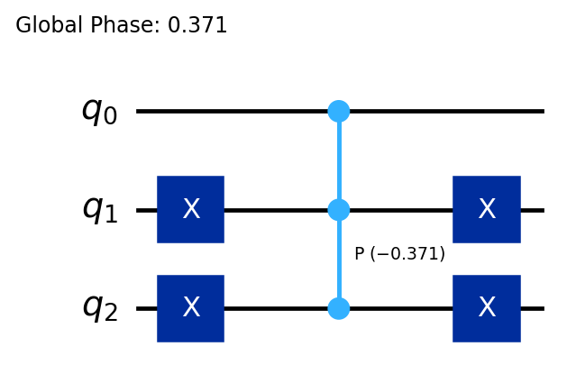

这是第一个实际子句 $C_1=(\neg x_{10}\lor x_6\lor x_8)$ 的局部电路。
此图将三个相关变量重新排为三根局部线：`q0,q1,q2` 对应外部变量 `[10,6,8]`，不表示整个问题只有 3 个变量。

从左到右读：

1. 左侧 X 翻转 `q1,q2`，把原来的失败情况 `x10=1,x6=0,x8=0` 映射为三线全 1。
2. 中间的受控相位门仅在三线全 1 时，把振幅乘以 $e^{-i0.371}$。
3. 右侧 X 撤销翻转，恢复原始变量值。
4. `Global Phase: 0.371` 给所有状态统一乘以 $e^{+i0.371}$，补全这一条子句的成本约定。

合起来，子句满足的状态得到 $e^{+i0.371}$，失败的状态得到 1。
**此时只改相位，不直接改振幅大小；后续 mixer 才利用相位差产生干涉。**
`0.371` 是核验用演示角度，不是训练得到的主实验参数。

### 4.3 两条 `PASS` 输出

```text
PASS: direct SAT phaser matches paper Eq. (4) on all 1024 assignments;
      max error=8.11e-17.
PASS: native SAT oracle phases on all 1024 assignments;
      all 8 flags return to zero; max error=5.59e-16.
```

第一条检查完整主实例相位器，比较每个赋值的振幅与公式给出的结果，包含全局相位。
`max error` 是复振幅差的最大绝对值，约 $10^{-16}$ 的误差属于浮点计算尺度。

第二条检查真实可逆 SAT oracle：所有满足态应翻负号、非满足态应保持符号，同时 8 个工作 flags 应恢复到 0。
验证在全部数据赋值的均匀叠加上进行；由于该电路保持数据赋值不变，可以同时检查各赋值的相位及工作位是否干净。

这些检查验证电路逻辑，不代表测量成功率为 100%。训练后的量子态仍可能包含非满足态。

结果保存在 [direct_sat_verification.csv](../results/data/direct_sat_verification.csv)：

- `check`：检查项目。
- `assignments`：检查的数据赋值数，1024。
- `data_qubits`：数据位数，10。
- `work_flags`：该检查使用的工作位数。
- `max_abs_error`：最大复振幅绝对误差。
- `passed`：是否通过阈值检查。

<a id="sec-5"></a>

## 5. QAOA 训练输出和训练图

对应 Notebook 第 4 节。

### 5.1 gamma、beta 与训练过程

第 $\ell$ 层先执行 $e^{-i\gamma_\ell H_C}$，再执行 mixer。

- $\gamma_\ell$：控制按成本添加的相位。
- $\beta_\ell$：控制各数据位的 `Rx(beta)` 旋转，使不同赋值之间发生混合与干涉。
- $p$ 层共 $2p$ 个参数。角度单位都是弧度，负数或超过 $2\pi$ 并不自动意味着错误。

训练过程：给出初始角度，模拟电路得到 $P(x)$，计算损失，再由 L-BFGS-B 调整角度，重复评估。

$$L(\gamma,\beta)=\langle H_C\rangle=-\sum_xP(x)\sum_j C_j(x).$$

每个深度使用 3 个初始点，选择损失最低的一组。`p=2` 的一个初始点来自已训练的 `p=1`，新增一层的角度先设为 0；`p=3` 同理继承 `p=2`。

这里训练使用精确态矢量概率。`good` 掩码用于记录 SAT 成功率，优化器返回的损失是论文 H_C 的期望值；它没有直接把 `1-P(SAT)` 当作损失。
较低的平均失败数与较高的 SAT 概率相关，但它们不是同一个优化目标。

### 5.2 控制台训练摘要

```text
p=1: <H_C>=-7.844557, <#UNSAT>=0.155443, P(SAT)=0.883289, pretrain=0.0354s, evals=168
p=2: <H_C>=-7.946090, <#UNSAT>=0.053910, P(SAT)=0.955870, pretrain=0.0700s, evals=248
p=3: <H_C>=-7.979531, <#UNSAT>=0.020469, P(SAT)=0.985406, pretrain=0.2077s, evals=521
```

- `p`：本次训练的电路深度。
- `<H_C>`：论文定义的平均成本，本题最低可能值是 -8。
- `<#UNSAT>`：输出分布中未满足子句数的期望，等于损失 `L` 加上 m。是平均值，所以可以是小数。
- `P(SAT)`：测出满足全部子句的任意一个赋值的精确概率。
- `pretrain`：当前深度这一轮训练的墙钟耗时，包含其多个初始点的优化，但不包含此前其他深度已花的时间。
- `evals`：所有初始点累计的损失函数调用次数。优化器一次迭代可能多次调用损失，因此它不同于迭代次数、shots 数或硬件电路执行次数。

本次 1、2、3 层的精确成功率分别约为 **88.33%、95.59%、98.54%**。
这说明本次更深的训练获得了更好结果，不是所有实例与优化过程都必然如此。

主实验选择 `p=2`。因为其 warm start 依赖 `p=1`，代码把所需预训练总时间记为：

$$T_{\rm pretrain}=T_{p=1}+T_{p=2}\approx0.1053408\ \mathrm{s}.$$

为展示深度对比而额外训练的 `p=3` 不计入所选 `p=2` 的训练成本。

### 5.3 参数表

文件：[trained_parameters.csv](../results/data/trained_parameters.csv)。

- `p`：这一行属于哪个深度的训练结果。
- `layer`：该电路内部的层号。
- `gamma_rad`、`beta_rad`：该层两个已训练的角度。
- `expected_cost`：整个 `p` 层电路最终的论文 H_C 期望值，也是训练目标。
- `expected_unsat`：成本加上 m 后得到的平均未满足数，作为辅助解释。
- `P_sat_exact`：整个 `p` 层电路最终的精确 SAT 概率。

例如 `p=2` 的两行一起组成一个两层电路：

```text
第 1 层：gamma =  0.7704655440，beta = -0.5471347241
第 2 层：gamma = -2.0300788010，beta =  0.3309912705
```

两行中的 `expected_unsat` 与 `P_sat_exact` 重复，是因为它们描述整个电路的最终表现，不是每一层结束时的中间表现。`p=1/2/3` 是三个不同的训练结果，不能把表中六行拼成一个六层电路。

### 5.4 图：训练收敛与深度比较

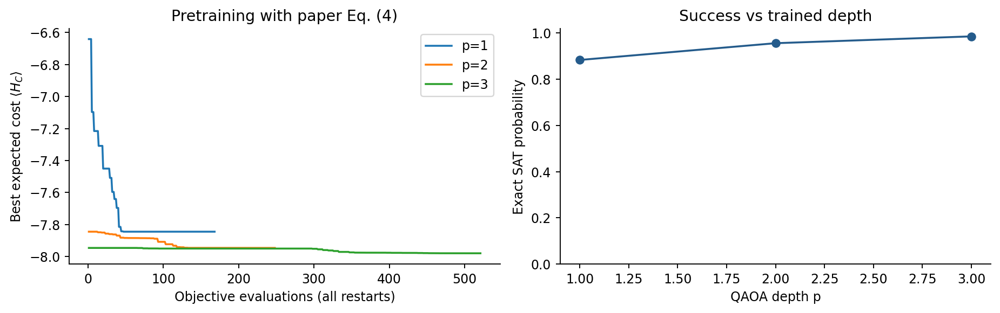

**左图**：横轴是目标函数评估次数，包含全部初始化；纵轴是截至该次评估为止发现的最低成本期望值 ⟨H_C⟩。曲线越低越好。
代码使用 `np.minimum.accumulate`，所以曲线不会上升。它不表示优化器每一步实际尝试的损失都下降；重新初始化时原始损失可能变高，只是图保留了历史最好值。

原始记录在 [training_convergence.csv](../results/data/training_convergence.csv)：`p` 是深度，`evaluation` 是评估序号，`expected_cost` 是该次原始损失，`expected_unsat` 是其加上 m 后的辅助统计，`P_sat` 是该次 SAT 概率。

**右图**：横轴为深度 `p`，纵轴为每个深度训练完成后的精确 SAT 概率。这里只比较结果质量，没有在同一张图中计入更深电路的门数和时间成本。

### 5.5 图：主 QAOA 电路

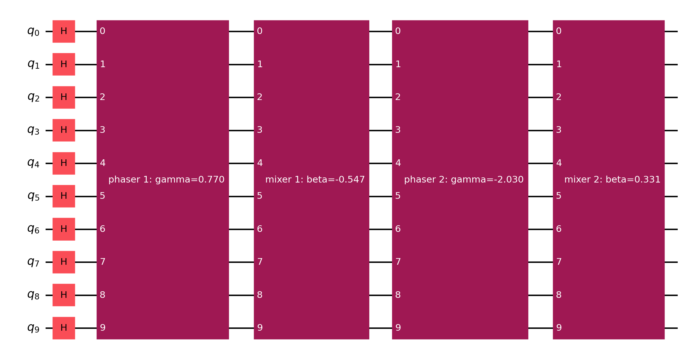

从左往右：10 根数据线先通过 H 门建立均匀叠加，然后依次通过 `phaser 1`、`mixer 1`、`phaser 2`、`mixer 2`。
大方框是为了阅读而封装的子电路，不是一枚物理门。方框上的 gamma、beta 是对应层的训练参数。
图中框内部的 `0…9` 是子电路端口编号，不是正在测量出来的 0/1 赋值。

<a id="sec-6"></a>

## 6. 固定 AA 轮数、oracle 和成功率曲线

对应 Notebook 第 5 节。

### 6.1 轮数选择输出

```text
P0= 0.9558699128522026 theta= 1.3591481090701474
Paper pi/(4 sqrt(P0))= 0.8033235252564226 ; floor= 0
Chosen first-peak integer R= 0
QAOA P=0.955870; QAOA+AA (R=0) P=0.955870
```

- `P0`：训练好的 QAOA 状态的 SAT 成功概率。
- `theta`：$\theta=\arcsin\sqrt{P_0}$，是 AA 二维旋转公式中的角度；它不是新增的训练参数。
- `Paper pi/(4 sqrt(P0))`：小成功概率下常见的轮数近似。
- `floor`：将该近似向下取整，作为对照。
- `Chosen first-peak integer R`：代码在第一个连续概率峰附近取整数候选，并加入 `R=0` 后，选出成功概率最大的候选。

精确公式为：

$$P_R=\sin^2\bigl[(2R+1)\theta\bigr],\qquad
R_{\rm first\ peak}=\frac{\pi}{4\theta}-\frac12.$$

本次 `P0` 已很高，按该规则选择 `R=0`。因此主 QAOA 与主固定 AA 的精确分布相同。
轮数选择使用了小模拟器给出的精确 `P0`，这个已知概率不能视为真实大规模运行中免费可得的信息。

**这里的 R=0 是“第一个峰附近的选择”，不是“所有整数轮数中成功概率最高”。**
曲线中 `R=7` 的成功概率约为 **99.89%**，高于 `R=0`；但它需要额外执行 7 次 AA，电路更深。
当前 `choose_rounds` 没有遍历全部轮数去最大化概率，也没有按最短总求解时间选择轮数。阅读“最优 R”时应带上这个限定。

### 6.2 图：一轮 AA 的组成

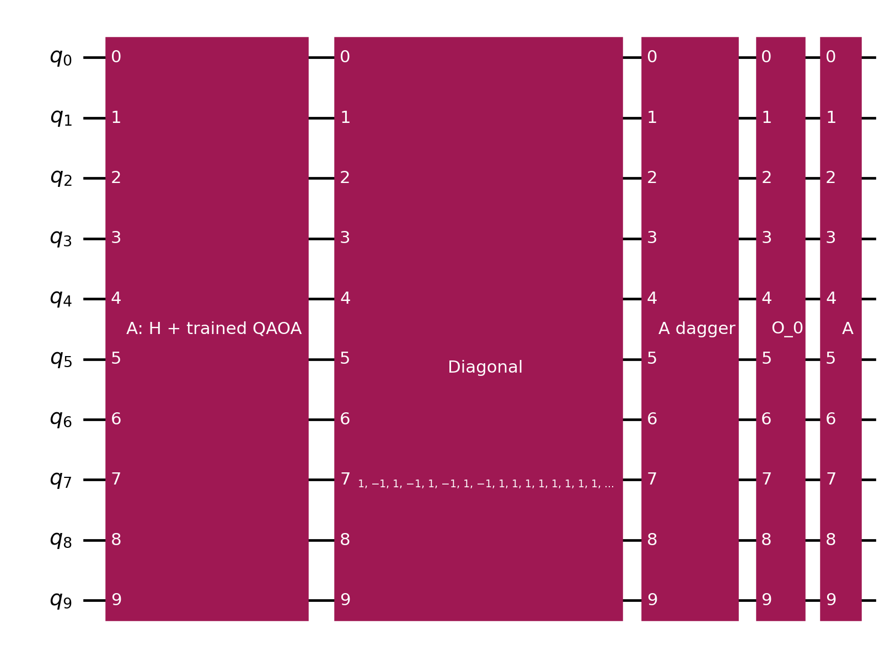

`A` 是完整状态制备：初始 H 加上训练好的 QAOA 层。
先执行一次 `A`，再执行一轮 AA。电路图按从左到右的顺序为：

```text
初始 A → O_C → A† → O_0 → A
```

一轮对应算符 $G=A O_0 A^\dagger O_C$，算符乘法从右向左作用。

- `O_C`：给满足全部子句的态翻转符号，振幅乘以 -1。
- `A†`：撤销状态制备。
- `O_0`：只给全零态翻负号。
- 最后的 `A`：结合前两步，实现关于已准备 QAOA 状态的反射。

此图故意画 `R=1`，方便看到所有模块，**不表示主统计实验实际用了 1 轮**。
图中的对角门是小规模模拟器的 SAT 相位 oracle；它由已枚举的 `good` 掩码生成。用于门时间估计的可逆实现见下一图，不把对角表当成真实硬件上的免费门。

### 6.3 图：可逆 SAT oracle

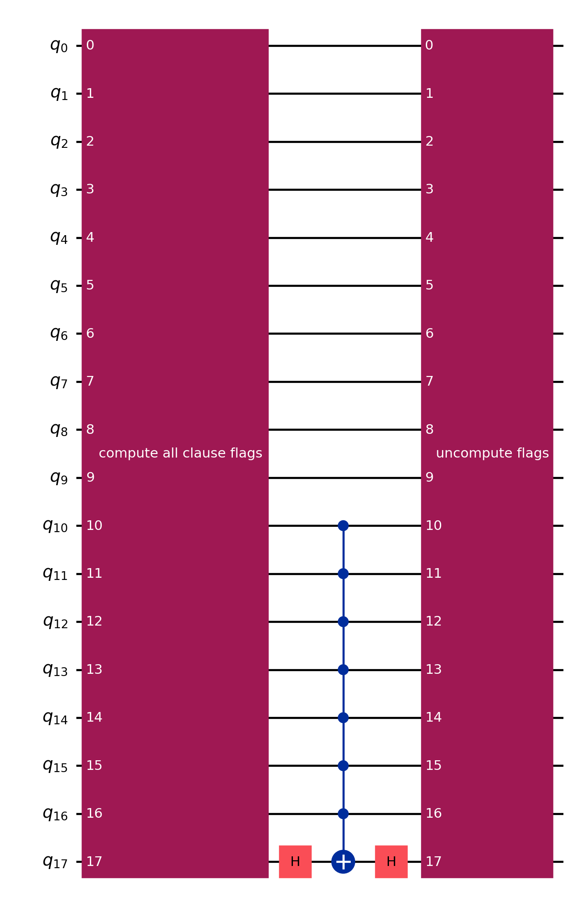

该图使用 10 个数据位和 8 个工作 flags，总共 18 根线。

1. `compute all clause flags`：把每个子句是否满足写入相应 flag。
2. 中间的联合受控相位：只有全部 8 个 flags 都为 1，才给整体态翻负号。
3. `uncompute flags`：反计算，把 flags 全部恢复为 0。

这些 flags 是临时计算空间，不是新的优化变量。它们不改变原 SAT 问题的解集合。
反计算保证工作位不残留与数据位的纠缠，后续反射才能按预期工作。

### 6.4 图：全零态反射

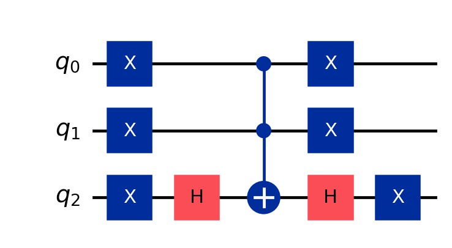

此图用 3 比特展示 $O_0=I-2|000\rangle\langle000|$ 的实现：先用 X 把全零映射为全一，做受控 Z 相位翻转，再撤销 X。
末线上的 `H—MCX—H` 把受控 X 变成受控 Z。
这是教学用 3 比特图，主电路的 `O_0` 作用于 10 个数据位。

### 6.5 图：AA 成功率随轮数变化

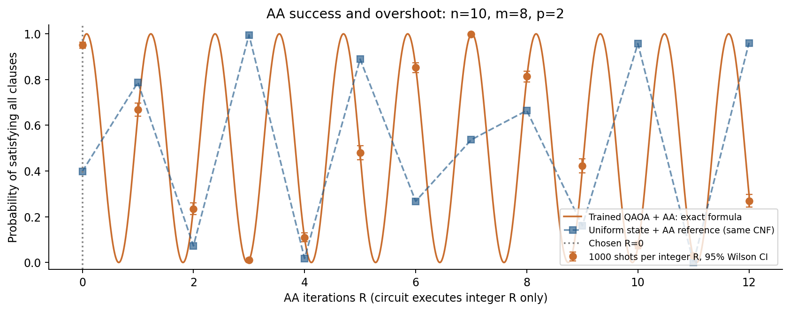

- 横轴：AA 轮数 `R`。实际电路执行整数轮；实线在非整数位置的取值只是公式的连续延伸。
- 纵轴：测得任意满足解的总概率。
- 橙色实线：训练后 QAOA 初态对应的精确 AA 公式。
- 橙色点与误差线：每个整数 `R` 独立采样 1000 次所得频率及 Wilson 95% 区间。
- 蓝色方点虚线：同一 CNF 从均匀初态开始 AA 的参考曲线。
- 竖直虚线：主实验选定的 `R_FIXED=0`。

本次数值包括：`R=0` 约 95.59%，`R=1` 约 64.82%，`R=3` 约 0.795%，`R=7` 约 99.89%。
AA 是旋转和干涉过程，成功率会振荡；增加轮数不保证每一步都更好。

曲线扫描使用 `amplify` 快速计算精确反射后的状态。Notebook 另外用实际 Qiskit 电路核验了所选轮数及 `R=1` 的结果。扫描不是对每个轮数进行真实量子硬件实验。

文件：[AA_success_vs_R.csv](../results/data/AA_success_vs_R.csv)。字段依次表示轮数 `R`、精确概率 `P_exact`、成功计数 `SAT_shots`、总 shots、估计频率 `P_estimate`、区间上下界 `CI_low/CI_high`。

该图 `R=0` 的样本成功数为 **952**，而后面主统计中是 **945** 或 **963**，因为三处使用不同采样种子，各自生成了独立样本。

<a id="sec-7"></a>

## 7. 1000-shot 统计与逐状态输出

对应 Notebook 第 6 节。

### 7.1 总成功率表

当前结果：QAOA 为 **945/1000=94.5%**，固定 QAOA+AA 为 **963/1000=96.3%**，Sparrow 为 **1000/1000=100%**。

文件：[success_accuracy.csv](../results/data/success_accuracy.csv)。

- `method`：方法名称。
- `SAT_outputs`：返回满足全部子句的结果数量。
- `trials_or_shots`：统计分母，当前均为 1000。
- `trial_unit`：QAOA/AA 的单位是一次电路测量；Sparrow 的单位是一次完整原生求解器运行。
- `SAT_rate`：成功数除以统计分母。
- `CI_low/CI_high`：根据有限次数统计计算的 Wilson 95% 区间。
- `measurements_or_calls`：测量次数或求解器调用次数。

Wilson 区间用于呈现统计不确定性，不是每个字符串的概率区间，也不是振幅误差。
即使观察到 1000 次全部成功，也不能据此证明未来每次必然成功；Sparrow 该行区间下界约为 99.617%。

**主固定 AA 使用 R=0，所以 96.3% 与 94.5% 的差异来自采样，不是 AA 的增益。**
两种固定电路的精确成功概率都约为 95.587%。

### 7.2 逐状态概率、计数和复振幅

文件：[all_output_probabilities_and_amplitudes.csv](../results/data/all_output_probabilities_and_amplitudes.csv)，包含全部 1024 个赋值。Notebook 只展示按精确 QAOA 概率排序的前 12 行。

赋值与正确性字段：

- `state`：显示顺序的比特串。
- `state_index`：该比特串作为二进制数对应的整数，例如 `1111000111` 对应 967。
- `is_SAT`：是否满足全部原始子句。
- `violated_clauses`：未满足子句数 `V(x)`。

概率和计数字段：

- `QAOA_probability_exact`：QAOA 输出此特定字符串的精确概率。
- `QAOA_count`：该字符串在 1000 shots 中出现的次数。
- `QAOA_frequency`：`QAOA_count/1000`。
- `AA_probability_exact`、`AA_count`、`AA_frequency`：固定 AA 的对应量。
- `Sparrow_count`、`Sparrow_empirical_frequency`：该字符串在 1000 次 Sparrow 运行中的次数和频率；不是量子 Born 概率。

复振幅字段：

- `QAOA_amplitude_real`、`QAOA_amplitude_imag`：$\alpha_x$ 的实部和虚部。
- `QAOA_amplitude_abs`：振幅大小 $|\alpha_x|$。
- `QAOA_phase_rad`：复振幅的相位角 $\arg\alpha_x$，单位弧度。
- `AA_amplitude_abs`、`AA_phase_rad`：固定 AA 后的对应量。

它们满足：

$$\alpha_x=a+ib,\qquad P(x)=|\alpha_x|^2=a^2+b^2.$$

例如状态 `1111000111`：振幅大小约 `0.06773`，精确概率约 `0.00458755`，即 **0.458755%**；QAOA 样本计数为 4，所以频率为 `0.004=0.4%`。

复振幅相位与所选全局相位约定有关。比较两个态是否表示同一物理状态时，可以允许相差统一的全局相位；概率不受它影响。

### 7.3 `most frequent output`

```text
QAOA: most frequent output=0001000001, count=8, SAT=True, ...
QAOA+AA: most frequent output=0001000001, count=9, SAT=True, ...
Sparrow: most frequent output=0101010001, count=12, SAT=True, ...
```

这是各自样本中出现次数最多的字符串，不一定是精确概率最大的字符串；有限样本会波动。
`original bits=[...]` 按内部索引从小到大给出，也就是外部变量 `x1…x10` 的顺序，与显示比特串相反。

最高振幅的字符串是 `1111000111`，而样本中最常见的是 `0001000001`，两者不同不代表计算错误。这里每个单态的概率都很小，1000 次测量只会给大多数单态留下少量计数。

### 7.4 图：总成功率与单态频率

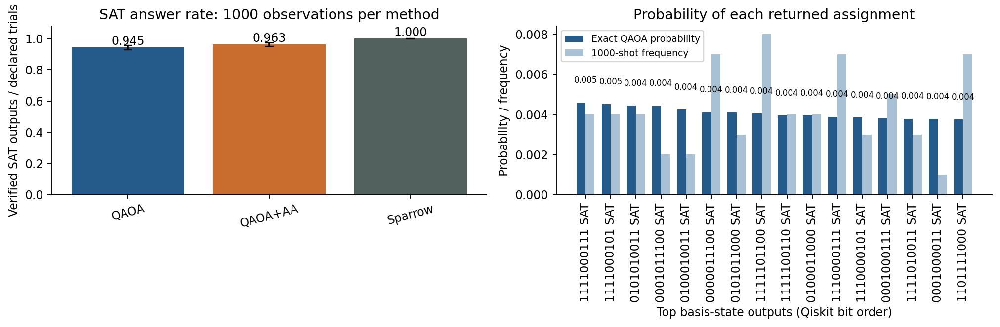

**左图**：三种方法每次观测返回有效 SAT 解的比例，误差线是 Wilson 95% 区间。量子柱子的差异要结合上面的 `R=0` 说明理解。

**右图**：选择精确 QAOA 概率最高的 16 个状态。深蓝色是精确概率，浅蓝色是 1000-shot 频率。
横轴是具体赋值并标注 `SAT/fail`，纵轴是单个字符串的概率或频率。标注 `0.005` 意味着约 0.5%，不是 5%。
这 16 根状态柱不是全部满足解，因此不能只把图中这些概率相加就当作总 SAT 概率。

### 7.5 Sparrow 每次运行的记录

文件：[sparrow_runs.csv](../results/data/sparrow_runs.csv)。

- `seed`：求解器随机种子，主批量为 1…1000。
- `status`：`SAT` 表示找到并核验了模型；预算内未找到时为 `UNKNOWN`，不据此认定无解。
- `model_bitstring`：返回的一组赋值，使用显示比特顺序。
- `model_valid`：独立 CNF 核验是否通过。
- `wall_time_s`：包含进程启动和输出的墙钟耗时。
- `cpu_time_s`：求解器自报的 CPU 时间，分辨率有限。
- `total_flips`：搜索期间的变量翻转次数；为 0 表示初始赋值已经满足。
- `exit_code`：原生进程退出码，当前成功运行使用 10。

Sparrow 是不完备的局部搜索求解器，找不到解不构成 UNSAT 证明。

<a id="sec-8"></a>

## 8. 振幅谱与 QAOA/AA 对比图

对应 Notebook 第 7 节。

### 8.1 先区分三个量

- 单个态的振幅大小：$|\alpha_x|$。
- 单个态的测量概率：$P(x)=|\alpha_x|^2$。
- 所有满足解的总成功概率：$P_{\rm SAT}=\sum_{x\in\mathrm{SAT}}|\alpha_x|^2$。

归一化要求 $\sum_x|\alpha_x|^2=1$。如果概率完全均匀集中于 408 个满足解，每个解的振幅也只有 $1/\sqrt{408}\approx0.0495$。
所以多解问题中，“解的概率总和很高”不要求每一个解的振幅都接近 1。
初始 1024 态均匀叠加中，每个态的振幅为 $1/\sqrt{1024}=0.03125$。

### 8.2 振幅摘要输出

```text
Largest amplitude: 1111000111, SAT=True, |alpha|=0.06773143,
individual P=0.459%
Total SAT probability across 408 answers: 95.587%
Top 20 are SAT: True.
Minimum SAT amplitude=0.03290; maximum non-SAT amplitude=0.02879.
SAT amplitudes all exceed non-SAT amplitudes in this run: True
```

- `Largest amplitude`：在全部 1024 态中按振幅大小取最大值，得到的字符串及其是否为解。
- `individual P`：这个单态的概率，不是总成功率。
- `Total SAT probability`：全部 408 个满足态的概率之和。
- `Top 20 are SAT`：振幅最高的前 20 个状态全部满足 CNF。
- `Minimum SAT amplitude`：408 个解中最小的振幅大小。
- `maximum non-SAT amplitude`：其余 616 个非解中最大的振幅大小。
- 最后一行：本次所有解的振幅都高于所有非解，是对这个具体结果的检查，不是一般 QAOA 的保证。

### 8.3 图：排序振幅谱

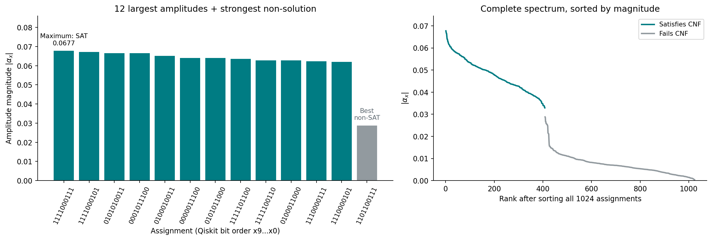

**左图**：展示最大 12 个振幅，并额外加入振幅最高的非解。青绿色表示满足态，灰色表示非满足态。纵轴是振幅大小，不是概率。

**右图**：把全部 1024 态按振幅从大到小排列。
横轴是排序名次，不是变量编号，也不是原状态整数编号。
曲线前 408 项为青绿色、后 616 项为灰色，源于本次所有满足态振幅均大于非满足态的性质。

排序只是调整显示顺序，没有对电路进行新的操作，也没有将概率进一步集中。

文件：[ranked_amplitudes.csv](../results/data/ranked_amplitudes.csv)。

- `rank_by_QAOA_magnitude`：按 QAOA 振幅从大到小的排名。
- `state/state_index/is_SAT`：状态和正确性标记。
- `QAOA_amplitude_abs/QAOA_probability_exact`：原 QAOA 振幅与概率。
- `AA_selected_amplitude_abs`：主实验所选固定轮数之后的振幅。
- `AA_R1_amplitude_abs`：额外执行一轮 AA 的诊断结果。

精确振幅和相位来自态矢量模拟。仅凭 1000 次计算基测量，不能直接恢复这些复振幅相位。

### 8.4 图：同一批状态的 QAOA 与 AA 振幅

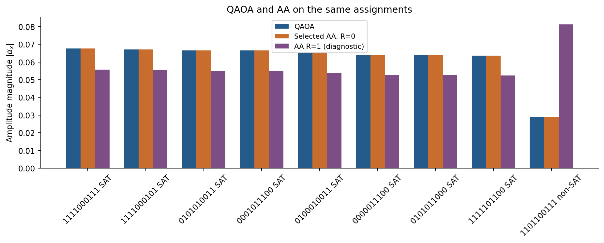

横轴统一采用 QAOA 最大 8 个振幅状态及最强非解，三组柱子都在同一批标签上比较，没有各自重新排序。

- 蓝色：QAOA。
- 橙色：主实验选定 AA，本次 `R=0`。
- 紫色：额外执行 `R=1`，用于检查过度放大。

蓝色与橙色等高，因为 `R=0` 没有改变状态。
紫色满足态柱子降低，与总成功率从约 95.59% 降至约 64.82% 一致。
这里“diagnostic”表示额外对照实验，不能把它误认为主统计所用的轮数。

AA 对全部满足态采用同一个振幅缩放因子，也对全部非满足态采用另一个缩放因子。因此它保持满足态内部的相对概率比例，不会自动选出其中一个指定答案。

<a id="sec-9"></a>

## 9. 无纠错门时间模型与本机计时

对应 Notebook 第 8 节。这一节同时出现了**假设门时间**和**实测 CPU 时间**，两者单位都可以是秒，但含义不同。

### 9.1 假设的门时间表

文件：[illustrative_non_ft_gate_times.csv](../results/data/illustrative_non_ft_gate_times.csv)。

代码把电路分解为 `x/h/rx/rz/cx`，假设所有比特可直接连接，安排不冲突的门并行执行。示例时长设为单比特门 50 ns、CX 300 ns、测量和重置各 1 μs。

`block` 是电路模块名称，`seconds_model` 是该模块在这组假设下的预计时长。当前结果为：

- `A: initial H + p phaser/mixer layers`：初始制备，约 **17.20 μs**。
- `O_C: compute + phase + uncompute`：可逆 SAT oracle，约 **54.65 μs**。
- `O_0: zero-state reflection`：10 比特全零反射，约 **102.35 μs**。
- `Full one-shot circuit, R=0`：主实验单次电路含重置、制备、测量，约 **19.20 μs**。

完整单次时间按下式计算：

$$t_R=t_{\rm reset}+t_A+R(2t_A+t_C+t_0)+t_{\rm measure}.$$

`R=0` 时不会执行两个 AA oracle，所以完整单次时间可以小于单独的 `O_C` 或 `O_0` 时间。
这些值是模型结果，不是实际硬件测量；没有套用原论文的纠错周期或资源工厂时间。

### 9.2 实测时间表

文件：[main_measured_time_comparison.csv](../results/data/main_measured_time_comparison.csv)。

- `method`：方法。
- `pretrain_wall_s`：主量子设置所需的经典训练时间；Sparrow 行为 0。
- `one_shot_simulator_wall_s`：量子行是 CPU 重建一次态矢量、抽一个结果并检查的耗时中位数；Sparrow 行实际是一个完整原生进程的耗时中位数，尽管共用该列名。
- `P_exact`：量子行是精确态矢量概率；**Sparrow 行实际填的是经验成功率，并不是数学证明的精确概率**。
- `shots_for_99pct`：按独立重复模型，至少一次成功达到 99% 所需的尝试次数。
- `cold_TTS99_simulator_s`：训练成本加上相应次数的单次尝试时间。

其中：

$$q_{99}=\left\lceil\frac{\log(1-0.99)}{\log(1-P)}\right\rceil,
\qquad T_{99}=t_{\rm pretrain}+q_{99}t_{\rm attempt}.$$

独立测量 $q$ 次，至少一次成功的概率为 $1-(1-P)^q$。
本次 `P≈0.95587`，一次不足 99%，两次达到约 99.805%，因此 `shots_for_99pct=2`。
Sparrow 按本次 1000/1000 的经验成功率代入时得到 1，但有限样本不证明其真实成功率必为 1。

当前 QAOA 行：训练约 **120.39 ms**，单次模拟约 **8.10 ms**，冷启动 `T99` 约 **136.58 ms**。Sparrow 主批量单次进程时间中位数约 **12.49 ms**。

单次模拟计时会为每一次计时尝试重新建立态矢量，重复 5 次后取中位数。它没有把一次状态计算时间直接除以 1000 当作单 shot 耗时。

### 9.3 图：本机单次尝试与冷启动时间

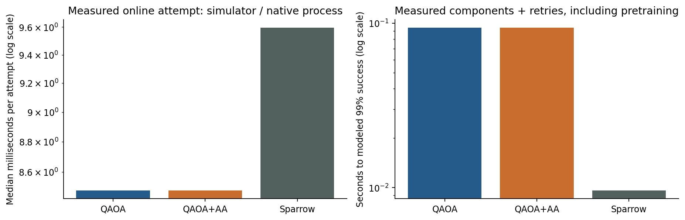

**左图**：三种方法的单次尝试时间，单位毫秒，纵轴为对数轴。量子方法是经典模拟器，Sparrow 是原生求解器进程。

**右图**：按上述概率重试模型估计的冷启动 `T99`，单位秒，包含量子预训练。对数轴上相同高度差代表相同倍数，不代表相同秒数差。

本次单次模拟可能比一次 Sparrow 进程短，但计入训练和所需尝试数后，冷启动时间仍较长。
图比较本机程序的不同执行方式，不能据此认定物理量子设备比经典求解器更快或更慢。

`WARNING: ... not quantum hardware speed` 是对数据含义的提醒，不是程序异常。

<a id="sec-10"></a>

## 10. 规模扫描、crossover 与启动检查

对应 Notebook 第 9 节。

### 10.1 `Completed n=...`

```text
Completed n=6, m=5: 3 matched instances
Completed n=8, m=6: 3 matched instances
Completed n=10, m=8: 3 matched instances
Completed n=12, m=10: 3 matched instances
```

这是规模扫描进度。每个规模 3 个实例，共 12 个；对同一个实例，量子方法与 Sparrow 使用同一份 CNF。
`m` 按 `round(0.8*n)` 取值，所以不是所有规模都有精确相同的 `m/n`。
扫描中每个实例独立训练 `p=2`，不复用主实例的角度；其训练方式也没有再单独先训练 `p=1`，因此扫描计时不应直接替代主实验的训练耗时。

Sparrow 对每个扫描实例运行 500 次，共 **6000 次**，本次全部返回核验通过的满足解。

### 10.2 扫描的两份 CSV

[crossover_all_instances.csv](../results/data/crossover_all_instances.csv) 每行一个实例：

- `n/m/instance`：规模和该规模内的实例编号。
- `seed/training_seed`：实例生成和参数训练的种子。`n=10, instance=0` 复用主 CNF。
- `p/R`：该实例选定的 QAOA 深度和固定 AA 轮数。
- `P_QAOA/P_AA`：精确成功概率。
- `Sparrow_SAT_rate`：500 次运行的经验成功率。
- `Sparrow_rate_CI_low/high`：该经验率的 Wilson 区间。
- `pretrain_s`：该实例独立训练时间。
- `QAOA_online_attempt_s/AA_online_attempt_s`：CPU 模拟一次尝试的中位时间。
- `Sparrow_process_attempt_s`：Sparrow 单次进程时间的中位数。
- `QAOA_cold_TTS99_s/AA_cold_TTS99_s`：训练加独立重试模型的时间。
- `Sparrow_TTS99_s`：Sparrow 按经验成功率代入重试模型得到的时间。

[crossover_medians.csv](../results/data/crossover_medians.csv) 按规模汇总，每行是该规模 3 个实例的对应 `T99` 中位数。`QAOA/QAOA+AA/Sparrow` 三列的单位都是**秒**，不是成功概率。

### 10.3 图：三联规模扫描

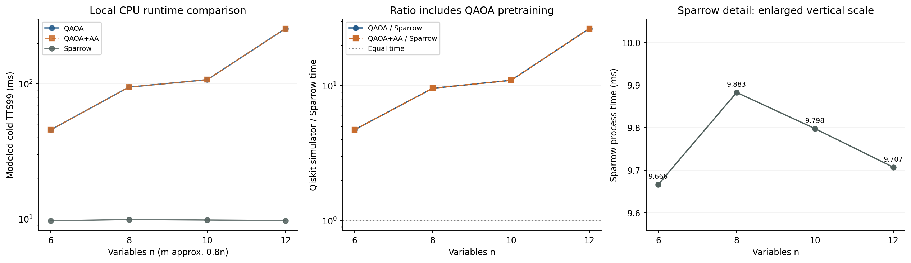

**左图**：横轴变量数 `n`，纵轴冷启动 `T99`，换为毫秒显示并使用对数轴。每个点是该规模 3 个实例的中位数。

**中图**：量子模拟方法与 Sparrow 的时间比值。高于水平线 1 表示本机模拟方法更慢；低于 1 才表示该计时定义下更快。

**右图**：只画 Sparrow，并缩小纵轴取值范围，让小幅波动可见。它不是另一种时间定义。

当前 Sparrow 四个规模的汇总时间约为 **10.230、11.064、11.017、11.363 ms**。
Notebook 文字中提到的约 9.7 ms 是早先一次运行的历史值；阅读当前结果时应以当前 CSV 和图中标注为准。

本次所有扫描实例选择 `R=0`，所以 QAOA 和 QAOA+AA 曲线重合。变量数增大时，经典态矢量模拟和训练的开销增加，不等于实际量子硬件具有同样的增长规律。

### 10.4 `time-curve crossings: NONE`

表示在 `n=6…12` 的已测区间内，没有观察到两条时间曲线相交。
`observed_crossings` 只在相邻采样点之间按对数比值插值，不向区间外预测。

它不表示 Sparrow 找不到解，也不证明更大规模永远没有交点。
这里的 `T99` 是用测量到的时间部件和成功率拼成的独立重试模型，不是实际记录“直到首次成功”的耗时分布后取得的第 99 百分位数。

### 10.5 图：Sparrow 启动/输出开销参照

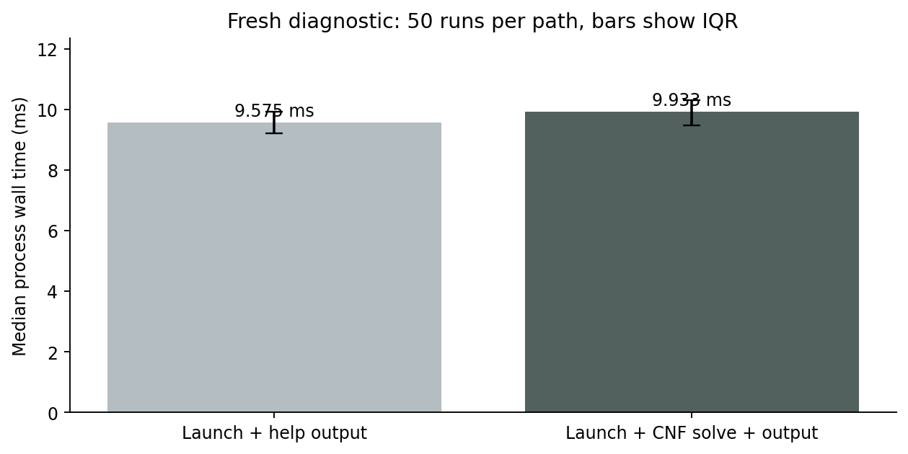

两根柱分别测量启动 Sparrow 并打印帮助、启动 Sparrow 并求解主 CNF 后打印结果。
先预热，每条路径再各记录 50 次；程序交错两种路径，减少运行先后顺序的影响。

- 柱高：50 次墙钟时间的中位数，单位毫秒。
- 误差线：第 25 到第 75 百分位数构成的四分位范围，**不是前面成功率图的 Wilson 区间**。
- 本次帮助路径中位数约 **12.447 ms**，求解路径约 **12.387 ms**。

两者量级相近，说明对这个很小的实例，启动与输出开销不容忽略。但这没有精确拆分出搜索本身占总时间的比例。
帮助与求解执行的代码和输出不同，且系统有波动，因此求解路径略快于帮助路径并不矛盾，也不能相减得出“负的搜索时间”。

文件 [sparrow_startup_check.csv](../results/data/sparrow_startup_check.csv) 记录 `mode`、重复编号 `repetition`、`wall_time_s`、状态和退出码。
文件 [sparrow_startup_check_summary.csv](../results/data/sparrow_startup_check_summary.csv) 中，`runs` 是样本数，`median_ms` 是中位数，`q25_ms/q75_ms` 是四分位数，`measured_at` 是测量时间及其时区。

`All 50 fresh CNF runs returned verified SAT models` 说明新检查中的 50 次求解也都得到有效赋值。
这批 50 次检查与主实验的 1000 次、扫描的 6000 次是分别记录的实验，耗时不必完全一致。

<a id="sec-11"></a>

## 11. 最后汇总、结果文件与检查项

对应 Notebook 第 10 节。

### 11.1 最后的汇总表

文件：[experiment_summary.csv](../results/data/experiment_summary.csv)。

- `n/m/p`：主问题规模和选定 QAOA 深度。
- `shots_per_fixed_circuit`：每个固定电路的采样数。
- `R_fixed`：主固定 AA 轮数。
- `P_QAOA_exact/P_AA_exact`：两个固定电路的精确成功概率。
- `QAOA_SAT_shots/AA_SAT_shots`：对应有限样本中的成功数。
- `Sparrow_runs/Sparrow_SAT_runs`：求解器总运行数和成功运行数。
- `main_pretrain_s`：所选主设置所需的训练总时间，包含 warm start 的前置训练。
- `python/qiskit/numpy/scipy`：本次运行环境版本。

### 11.2 最后几条断言

代码检查两组主量子样本各恰好 1000 次、态矢量概率归一化、采样计数非负。
前面还核验了 NumPy 快速演化与 Qiskit 态矢量在允许全局相位后相同，以及 AA 电路与公式相同。

`Completed. Figures: ... ; CSV: ...` 表示程序已经走到最后，并显示保存位置。
如果断言失败会报错，不能把留存的旧图当作本次成功运行结果。

### 11.3 图文件说明

本说明嵌入了当前生成的全部 **13 张 PNG 图**。每张在 `results/figures/` 中还有同名 PDF，便于放大或用于汇报。
文件编号缺少 `08` 是删除旧实验后保留了后续图的原编号，不代表当前 Notebook 漏跑了一节。

训练输出在 `results/data/trained_parameters.csv` 和 `training_convergence.csv`；每个字符串的完整输出在 `all_output_probabilities_and_amplitudes.csv`；其余 CSV 已在对应部分链接并解释。

<a id="sec-12"></a>

## 12. 常见疑问

### 为什么有 408 个解，却只打印几个字符串？

打印前 12 个参考解或概率最高的若干状态是为了缩短显示。完整逐状态数据仍包含 1024 行；求解成功只要求返回任意一个有效赋值。

### 为什么 `<#UNSAT>` 不是 `1-P(SAT)`？

`1-P(SAT)` 是“至少违反一条”的概率，而 `<#UNSAT>` 还要考虑失败时违反了几条。一次违反 3 条对后者贡献 3，对前者只记一次失败事件。
例如 `p=2` 的失败概率约 0.04413，平均未满足数约 0.05391，两者可以不同。

### 为什么 p=3 的成功率更高，后面仍用 p=2？

`P_SELECTED=2` 是当前主实验设定。代码同时训练其他深度用于比较，并没有自动按最大成功率切换主设置。改深度后，后续参数、AA 轮数、统计和计时都需要重新运行。

### 为什么 AA 没有让主结果变好？

主设置按第一个峰附近的候选规则选择 `R=0`，它与 QAOA 状态相同。
额外一轮会过度旋转；更晚的峰可以再次提高概率，但代价是更多电路模块。不能仅凭成功率决定哪种设置总体更快。

### 为什么解的振幅只有 0.06 左右？

成功概率分布在很多解上。应把所有满足态的**振幅平方**相加，而不是把振幅直接相加，也不是要求单个解的振幅接近 1。

### 这些训练和测量是在量子电脑上运行的吗？

当前是经典电脑上的理想态矢量模拟。训练反复调用 NumPy 演化，固定电路通过 Qiskit 生成态矢量并交叉验证，shots 从概率分布抽样。
CNF 全枚举和对角 oracle 是小规模模拟的便利条件，不能把它们当作大实例上免费可用的资源。

### “原始 SAT 方法”为什么仍然出现 18 根线？

主 QAOA 相位器和 mixer 使用 10 个数据位。可逆 SAT oracle 另用 8 个会归零的工作位；总共 18 根线描述的是一次可逆逻辑计算，不是 18 个独立的 SAT 优化变量。

### 为什么不能用本机图宣布量子优势？

量子算法在 CPU 上模拟的时间，与实际量子设备运行门电路的时间是不同量。当前结果能说明代码在这些小实例上的输出和经典执行开销；物理量子硬件的速度还需独立的硬件实验或有充分依据的资源模型。


## 新增：大方框内部的门图

Notebook 已在 QAOA 与 oracle 小节加入实际门图，详细读法见 [电路展开图解](circuit_expansion_guide_zh.md)。这些图使用原来的 CNF 与已经训练好的 p=2 参数。

- `03b_main_QAOA_expanded`：完整两层 QAOA。先 H，再执行各层四批子句相位门与逐位 Rx。
- `03c_first_phaser_expanded`：第一层 phaser 的 4 个分色批次，所有子句共用 gamma1。
- `03d_first_mixer_expanded`：10 根数据线各一个 Rx(beta1)。
- `05b_SAT_oracle_expanded`：18 线可逆 CNF oracle 的计算、相位标记、反计算。
- `05c_one_clause_flag_expanded`：第一个实际子句如何写入工作位。
- `05d_all_flags_phase_expanded`：8 个 flags 全为 1 时怎样翻相位。
- `05e_one_clause_flag_elementary`：同一子句计算模块继续拆到单比特门和 CX。

主 AA 的 `DiagonalGate` 使用全枚举得到的满足态布尔数组，便于小规模模拟；上述 18 线 `sat_oracle_with_flags` 是另外从 CNF 构造并核验的可逆实现。二者在工作位从零开始时，对数据位产生相同的相位作用。将 `boxed=False` 用于主 AA，并不会自动把 DiagonalGate 换成 18 线实现。

独立模块编译到 `x/h/rx/rz/cx` 时显式使用 `qubits_initially_zero=False`，使该模块也适用于非零或叠加的数据输入。修正编译方式后，示意门时间模型的可逆 O_C 为约 54.65 μs。该变化只影响假设的门时间模型，保留原来的实验概率、采样计数和本机 CPU 实测时间。

最新 PPT 的页码与图表读法，见 [27 页 PPT 逐页中文讲解](ppt_slide_guide_zh.md)。
